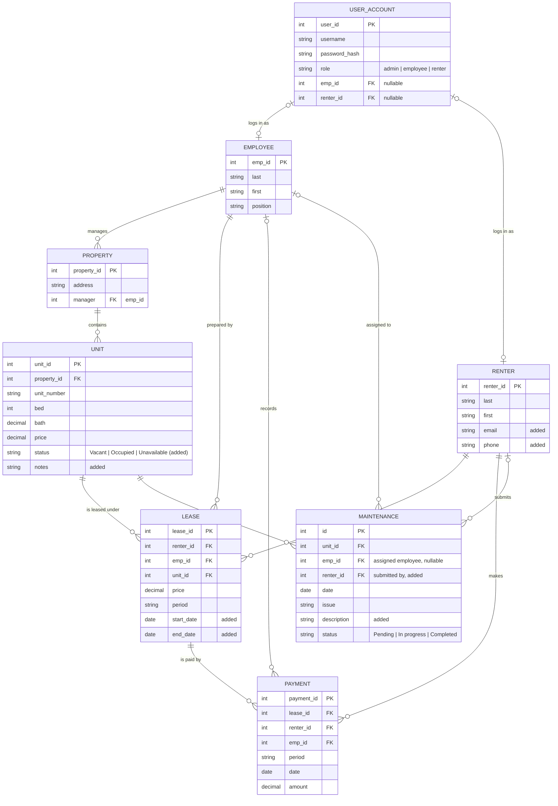

# Entity Relationship Diagram

Cowboy Property Management, IS 6465 Group 3: Alex King, Christian Sorensen, Nasly Gamboa

This model starts from the instructor's suggested ERD for the Cowboy Property Management project (`suggested-erd-instructor.png`) and updates it for our use cases. The midterm covers two CRUD sets, rental units and maintenance requests. The rest of the entities are kept so the final project (leases, payments, reports, login) builds on the same schema.

## Changes from the suggested ERD

The project description says the suggested ERD "may need to be updated." These are our changes and why.

| Change | Reason |
|---|---|
| Added `USER_ACCOUNT` | The project requires "Login and user management" and the final rubric requires authentication with at least two roles. Credentials are kept out of EMPLOYEE and RENTER so one login table serves both. |
| Added `UNIT.status` | Our Unit Management use cases (UC-01 to UC-04) and wireframe show Vacant / Occupied for each unit. Status could be derived from an active lease; storing it keeps the midterm pages simple and lets a manager mark a unit Unavailable (for example, under repair). |
| Added `UNIT.notes` | Appears on the Add / Edit Unit wireframe. |
| Added `MAINTENANCE.description` | The suggested `Issue` is a short category. Residents need a longer description of the problem (UC-05). |
| Added `MAINTENANCE.renter_id` | Residents submit requests (UC-05). The suggested ERD only linked the assigned employee. Nullable because an employee may enter a request on a resident's behalf. |
| Added `RENTER.email`, `RENTER.phone` | Needed to contact a renter about a request and to match a login account. |
| Added `LEASE.start_date`, `LEASE.end_date` | `Period` alone cannot tell the system whether a lease is active, which the Resident column on the unit list and the overdue report both need. |
| `PROPERTY.manager` is a foreign key to `EMPLOYEE.emp_id` | The description says "each property having a property manager." Modeled as one employee manages many properties. |

Everything else (entity names, primary keys, `Bed`, `Bath`, `Price`, `Period`, `Amount`, the LEASE and PAYMENT links) is kept as suggested.

## Entity purpose and midterm coverage

| Entity | Purpose | Midterm pages |
|---|---|---|
| UNIT | A rentable unit inside a property | `unit/` CRUD (UC-01 to UC-04) |
| MAINTENANCE | A repair or service request against a unit | `maintenance/` CRUD (UC-05 to UC-08) |
| PROPERTY | A building Cowboy manages; shown as the Property column on unit pages | Referenced |
| RENTER | The resident; shown as the Resident column via the active lease | Referenced |
| EMPLOYEE | Property managers and maintenance staff; shown as Assigned to on requests | Referenced |
| LEASE, PAYMENT, USER_ACCOUNT | Final project: leases, payments and overdue report, login and user management | Not yet |

## Business rules the model enforces

| ID | Rule |
|---|---|
| BR-01 | A unit belongs to exactly one property. |
| BR-02 | A unit has at most one active lease at a time (start_date <= today <= end_date). Status is Occupied only when an active lease exists. |
| BR-03 | A maintenance request must reference an existing unit. |
| BR-04 | Request status moves Pending, then In progress, then Completed. Only an employee or admin may change status or assignment. |
| BR-05 | A renter may only see requests for units on their own active lease. |
| BR-06 | A unit with an active lease or an open request cannot be deleted. |
| BR-07 | Passwords are stored as hashes, never plain text. |
| BR-08 | Delete is reserved for duplicate or mistaken records. A finished request keeps status Completed and an off-market unit is marked Unavailable, so history is preserved (Week 6 guidance: prefer a status change unless a business rule requires deletion). |

## Notes on identifiers

Primary keys are integers, following the Week 6 `INTEGER PRIMARY KEY` pattern. The `REQ-001` labels shown on the midterm pages are a display format for `MAINTENANCE.id`; the unit number shown on the unit pages is the `unit_number` column, not the `unit_id` key. Every UPDATE and DELETE in the final project will use the integer key in its WHERE clause.
