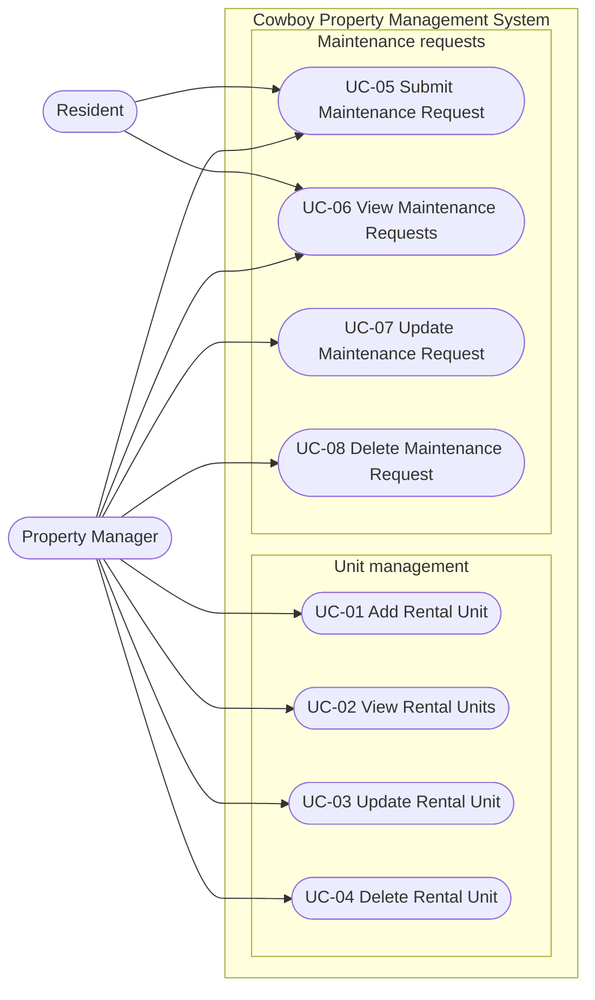

# Use Case Model

Cowboy Property Management, IS 6465 Group 3: Alex King, Christian Sorensen, Nasly Gamboa

Two CRUD use case sets are in scope for the midterm: rental unit management and maintenance requests. Login and the dashboard are supporting pages, not use cases, and will connect to the database in the final project. These two sets are drawn from the project description's Admin/Employee list ("Properties and their property units", "Maintenance requests") and Renter list (maintenance requests a renter submits and tracks).

## Actors and goals

| Actor | Description | Goals |
|---|---|---|
| Property Manager | Cowboy Properties employee responsible for one or more properties (EMPLOYEE in the ERD; "Admin/Employee" in the project description) | Add, view, update, and delete rental units; view, update, and delete maintenance requests |
| Resident | Tenant with an active lease on a unit (RENTER in the ERD; "Renter" in the project description) | Submit a maintenance request; view own requests and their status |

## Use case diagram

## Use case index

| ID | Use case | Primary actor | Pages | Document |
|---|---|---|---|---|
| UC-01 | Add Rental Unit | Property Manager | `unit/add-unit.php` | [UC-01](use-cases/UC-01-add-rental-unit.md) |
| UC-02 | View Rental Units | Property Manager | `unit/units.php`, `unit/unit-details.php` | [UC-02](use-cases/UC-02-view-rental-units.md) |
| UC-03 | Update Rental Unit | Property Manager | `unit/edit-unit.php` | [UC-03](use-cases/UC-03-update-rental-unit.md) |
| UC-04 | Delete Rental Unit | Property Manager | `unit/delete-unit.php` | [UC-04](use-cases/UC-04-delete-rental-unit.md) |
| UC-05 | Submit Maintenance Request | Resident, Property Manager | `maintenance/add-maintenance.php` | [UC-05](use-cases/UC-05-submit-maintenance-request.md) |
| UC-06 | View Maintenance Requests | Resident, Property Manager | `maintenance/maintenance.php`, `maintenance/request-details.php` | [UC-06](use-cases/UC-06-view-maintenance-requests.md) |
| UC-07 | Update Maintenance Request | Property Manager | `maintenance/edit-maintenance.php` | [UC-07](use-cases/UC-07-update-maintenance-request.md) |
| UC-08 | Delete Maintenance Request | Property Manager | `maintenance/delete-maintenance.php` | [UC-08](use-cases/UC-08-delete-maintenance-request.md) |

Each use case document contains the specification, main success scenario, alternative flows, activity diagram, and the wireframe(s) it maps to.
