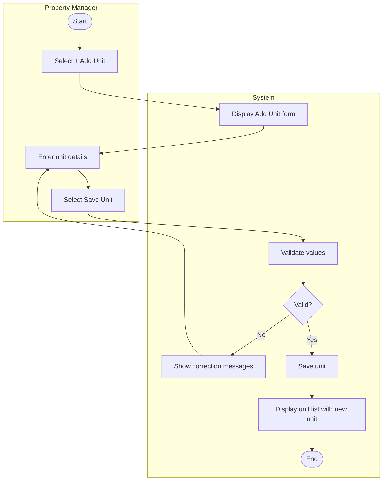

# UC-01 Add Rental Unit

## Specification

| Element | Specification |
|---|---|
| Name | Add Rental Unit |
| Goal | Record a new rental unit so it can be leased and tracked |
| Primary actor | Property Manager |
| Trigger | Property Manager selects **+ Add Unit** on the dashboard or the Unit Management page |
| Precondition | Property Manager is logged in; the property the unit belongs to already exists |
| Success outcome | The unit is saved and appears in the unit list |
| Failure outcome | The form remains visible with specific correction messages |

## Main success scenario

1. Property Manager selects **+ Add Unit**.
2. System displays the Add Unit form.
3. Property Manager enters unit number, property, bedrooms, bathrooms, monthly rent, status, and optional notes.
4. Property Manager selects **Save Unit**.
5. System validates the submitted values.
6. System saves the unit and returns to the unit list showing the new unit.

## Alternative flows

| Branch | Condition | System response |
|---|---|---|
| 5a | Unit number or property is missing | Show a required field message |
| 5b | Unit number already exists for that property | Show a duplicate unit message |
| 5c | Bedrooms, bathrooms, or rent is not a non-negative number | Show a numeric value message |
| 5d | Status is not Vacant, Occupied, or Unavailable | Show a status message |
| 5e | Unexpected processing error | Show a safe general message |
| 3a | Property Manager selects **Cancel** | Return to the unit list with no change |

## Activity diagram

## Notes

The proposal says unit management will "associate residents with their assigned units." In the ERD this happens through LEASE (renter_id, unit_id), not a field on the unit form, so the Resident column on the unit list is read from the active lease. Lease CRUD is a final-project use case.

## Wireframes

- `docs/wireframes/04-add-edit-unit.png` (Add / Edit Unit form)
- `docs/wireframes/03-unit-management.png` (unit list after save)
