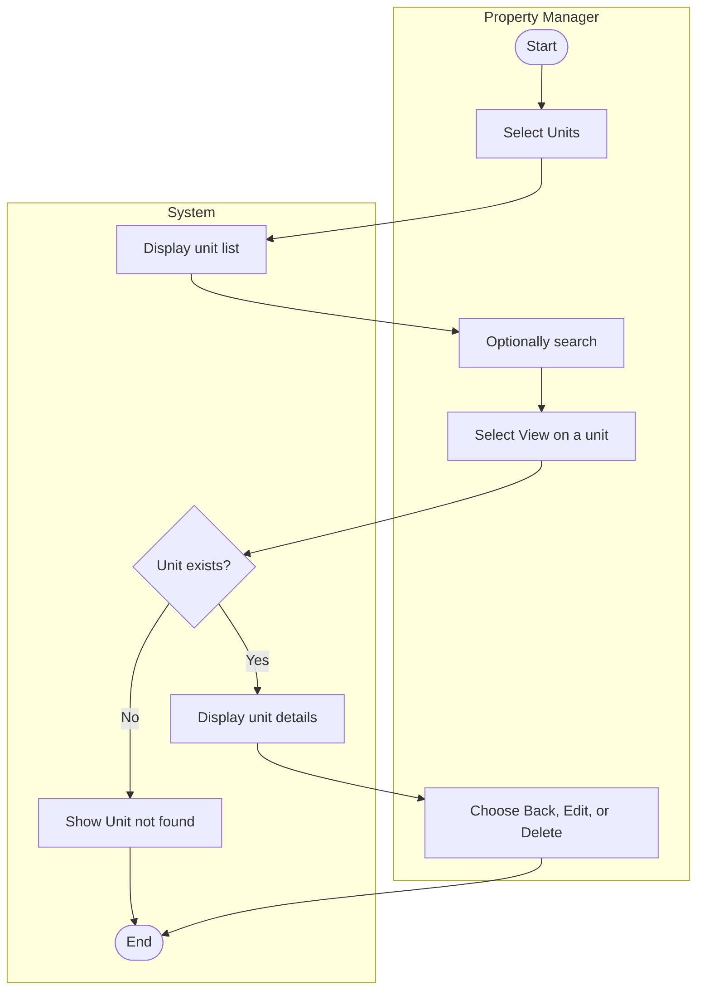

# UC-02 View Rental Units

## Specification

| Element | Specification |
|---|---|
| Name | View Rental Units |
| Goal | See which units exist, their status, and who lives in them, and open one unit for full details |
| Primary actor | Property Manager |
| Trigger | Property Manager selects **Units** in the sidebar |
| Precondition | Property Manager is logged in |
| Success outcome | The unit list is displayed; selecting a unit shows its details |
| Failure outcome | A "Unit not found" message is shown if the selected unit does not exist |

## Main success scenario

1. Property Manager selects **Units**.
2. System displays the unit list with unit number, property, status, current resident, and actions.
3. Property Manager optionally types in the search box to narrow the list.
4. Property Manager selects **View** on a unit.
5. System displays the unit details: unit, property, status, resident, bedrooms, bathrooms, and rent.
6. Property Manager selects **Back to units**, **Edit** (UC-03), or **Delete** (UC-04).

## Alternative flows

| Branch | Condition | System response |
|---|---|---|
| 2a | No units exist | Show an empty list message and the **+ Add Unit** button |
| 3a | Search has no matches | Show "No units match" |
| 5a | Unit id in the URL does not exist | Show "Unit not found" with a link back to the list |

## Activity diagram

## Wireframes

- `docs/wireframes/03-unit-management.png` (unit list)
- `docs/wireframes/07-unit-details.png` (unit details page, `unit/unit-details.php`)
