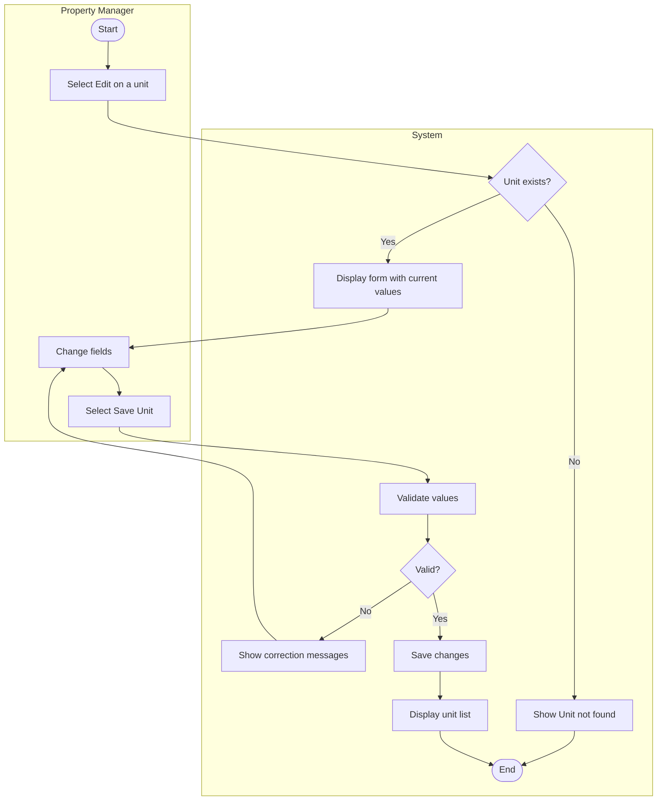

# UC-03 Update Rental Unit

## Specification

| Element | Specification |
|---|---|
| Name | Update Rental Unit |
| Goal | Correct or change a unit's details (rent, status, bedrooms, notes) so records stay accurate |
| Primary actor | Property Manager |
| Trigger | Property Manager selects the pencil icon on the unit list or **Edit** on unit details |
| Precondition | Property Manager is logged in; the unit exists |
| Success outcome | The changes are saved and the unit list reflects them |
| Failure outcome | The form remains visible with the entered values and specific correction messages |

## Main success scenario

1. Property Manager selects **Edit** for a unit.
2. System displays the Edit Unit form prepopulated with the current values.
3. Property Manager changes one or more fields.
4. Property Manager selects **Save Unit**.
5. System validates the submitted values.
6. System saves the changes and returns to the unit list.

## Alternative flows

| Branch | Condition | System response |
|---|---|---|
| 2a | Unit id in the URL does not exist | Show "Unit not found" with a link back to the list |
| 5a | Unit number or property is missing | Show a required field message |
| 5b | Bedrooms, bathrooms, or rent is not a non-negative number | Show a numeric value message |
| 5c | Status changed to Vacant while an active lease exists | Show a lease conflict message (BR-02) |
| 5d | Unexpected processing error | Show a safe general message |
| 3a | Property Manager selects **Cancel** | Return to the unit list with no change |

## Activity diagram

## Notes

The proposal says unit management will "associate residents with their assigned units." In the ERD this happens through LEASE (renter_id, unit_id), not a field on the unit form, so the Resident column on the unit list is read from the active lease. Lease CRUD is a final-project use case.

## Wireframes

- `docs/wireframes/04-add-edit-unit.png` (same form as Add, prepopulated)
