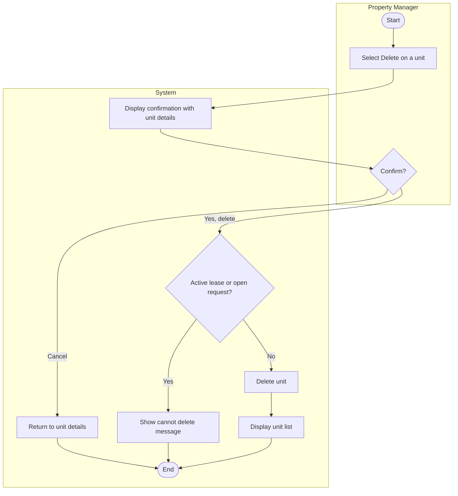

# UC-04 Delete Rental Unit

## Specification

| Element | Specification |
|---|---|
| Name | Delete Rental Unit |
| Goal | Remove a unit that was entered in error or no longer exists. A unit that is simply off the market is marked Unavailable rather than deleted, so its lease and request history is kept (BR-06) |
| Primary actor | Property Manager |
| Trigger | Property Manager selects the trash icon on the unit list or **Delete** on unit details |
| Precondition | Property Manager is logged in; the unit exists |
| Success outcome | The unit is removed and no longer appears in the unit list |
| Failure outcome | The unit remains and the system explains why it cannot be deleted |

## Main success scenario

1. Property Manager selects **Delete** for a unit.
2. System displays a confirmation page showing the unit's details.
3. Property Manager selects **Yes, delete unit**.
4. System checks that the unit has no active lease and no open maintenance requests.
5. System deletes the unit and returns to the unit list.

## Alternative flows

| Branch | Condition | System response |
|---|---|---|
| 2a | Unit id in the URL does not exist | Show "Unit not found" with a link back to the list |
| 3a | Property Manager selects **Cancel** | Return to unit details with no change |
| 4a | Unit has an active lease or open request (BR-06) | Show a message explaining the unit cannot be deleted yet |
| 5a | Unexpected processing error | Show a safe general message |

## Activity diagram

## Wireframes

- `docs/wireframes/08-delete-unit.png` (delete confirmation page, `unit/delete-unit.php`)
- `docs/wireframes/03-unit-management.png` (trash icon in Actions column, list after delete)
