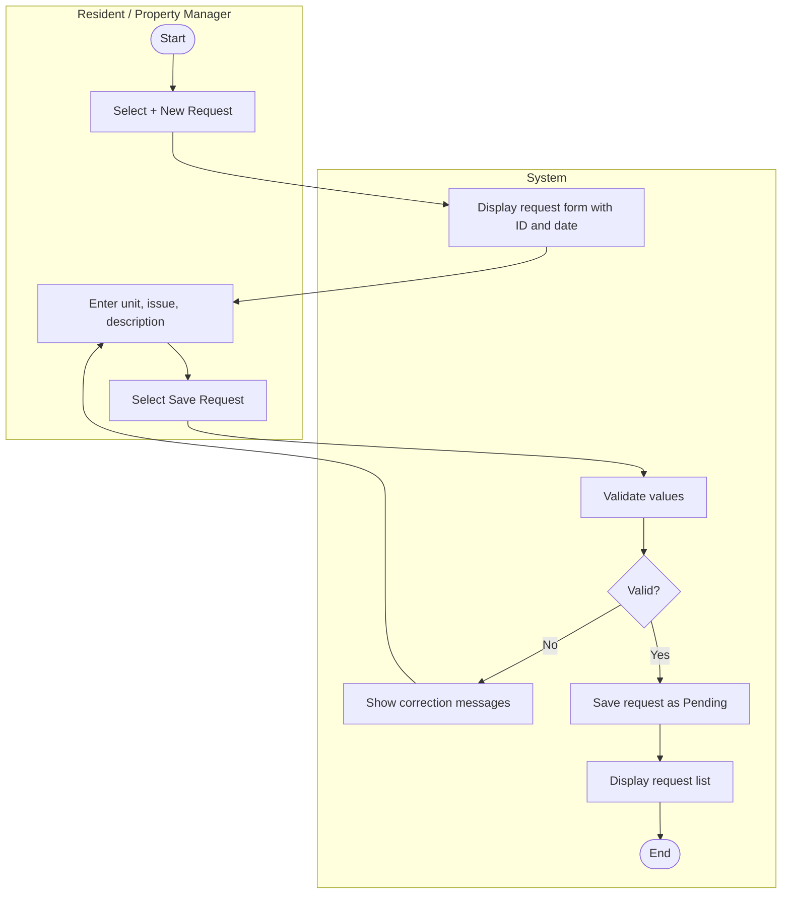

# UC-05 Submit Maintenance Request

## Specification

| Element | Specification |
|---|---|
| Name | Submit Maintenance Request |
| Goal | Report a problem with a unit so the property manager can get it fixed |
| Primary actor | Resident (a Property Manager may also submit on a resident's behalf) |
| Trigger | Actor selects **+ New Request** on the Maintenance Requests page |
| Precondition | Actor is logged in; the unit exists. A Resident must have an active lease on the unit |
| Success outcome | The request is saved with status Pending and appears in the request list |
| Failure outcome | The form remains visible with specific correction messages |

## Main success scenario

1. Actor selects **+ New Request**.
2. System displays the maintenance request form with the next request ID and today's date filled in.
3. Actor enters the unit, issue category, and a description. A Property Manager may also set assigned to.
4. Actor selects **Save Request**.
5. System validates the submitted values.
6. System saves the request with status Pending and returns to the request list.

## Alternative flows

| Branch | Condition | System response |
|---|---|---|
| 5a | Unit, issue, or description is missing | Show a required field message |
| 5b | Unit does not exist, or Resident does not lease that unit (BR-05) | Show a unit message |
| 5c | Description is shorter than 10 or longer than 500 characters | Show a description length message |
| 5d | Date submitted is in the future | Show a date message |
| 5e | Unexpected processing error | Show a safe general message |
| 3a | Actor selects **Cancel** | Return to the request list with no change |

## Activity diagram

## Wireframes

- `docs/wireframes/06-submit-maintenance-request.png` (request form)
- `docs/wireframes/05-maintenance-requests.png` (request list after save)
