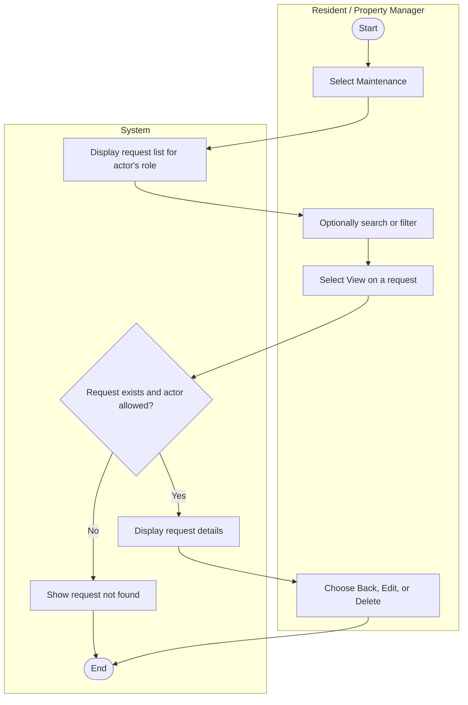

# UC-06 View Maintenance Requests

## Specification

| Element | Specification |
|---|---|
| Name | View Maintenance Requests |
| Goal | Track the status of maintenance requests and open one for full details |
| Primary actor | Property Manager (sees all requests); Resident (sees only requests for their own unit) |
| Trigger | Actor selects **Maintenance** in the sidebar, or **View Request** on the dashboard |
| Precondition | Actor is logged in |
| Success outcome | The request list is displayed, filtered by role; selecting a request shows its details |
| Failure outcome | A "Maintenance request not found" message is shown if the selected request does not exist or the Resident is not allowed to see it |

## Main success scenario

1. Actor selects **Maintenance**.
2. System displays the request list with request ID, unit, issue, status, date submitted, and actions. Residents see only their own unit's requests.
3. Actor optionally searches by unit, issue, or request ID, or filters by status.
4. Actor selects **View** on a request.
5. System displays the request details: ID, unit, issue, description, date submitted, assigned to, and status.
6. Property Manager may select **Edit** (UC-07) or **Delete** (UC-08). Resident selects **Back**.

## Alternative flows

| Branch | Condition | System response |
|---|---|---|
| 2a | No requests exist for this actor | Show an empty list message and the **+ New Request** button |
| 3a | Search or filter has no matches | Show "No requests match" |
| 5a | Request id in the URL does not exist | Show "Maintenance request not found" |
| 5b | Resident requests a record for a unit they do not lease (BR-05) | Show "Maintenance request not found" (do not reveal that it exists) |

## Activity diagram

## Wireframes

- `docs/wireframes/05-maintenance-requests.png` (request list)
- `docs/wireframes/02-dashboard.png` (recent requests panel and View Request button)
- `docs/wireframes/09-request-details.png` (request details page, `maintenance/request-details.php`)
