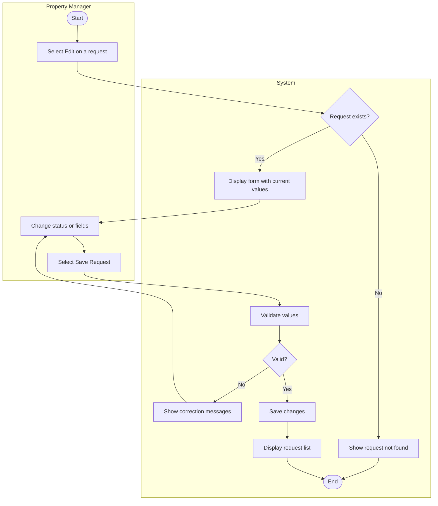

# UC-07 Update Maintenance Request

## Specification

| Element | Specification |
|---|---|
| Name | Update Maintenance Request |
| Goal | Move a request through Pending, In progress, and Completed, and assign it to someone, so residents can see progress |
| Primary actor | Property Manager |
| Trigger | Property Manager selects the pencil icon on the request list or **Edit** on request details |
| Precondition | Property Manager is logged in; the request exists |
| Success outcome | The changes are saved and the list shows the new status |
| Failure outcome | The form remains visible with the entered values and specific correction messages |

## Main success scenario

1. Property Manager selects **Edit** for a request.
2. System displays the Edit Request form prepopulated with the current values.
3. Property Manager changes the status, assigned to, or other fields.
4. Property Manager selects **Save Request**.
5. System validates the submitted values.
6. System saves the changes (recording a completion date when status becomes Completed) and returns to the request list.

## Alternative flows

| Branch | Condition | System response |
|---|---|---|
| 2a | Request id in the URL does not exist | Show "Maintenance request not found" |
| 5a | Status is not Pending, In progress, or Completed | Show a status message |
| 5b | Description is shorter than 10 or longer than 500 characters | Show a description length message |
| 5c | Date submitted is invalid or in the future | Show a date message |
| 5d | Actor is a Resident (BR-04) | Show the unauthorized page |
| 5e | Unexpected processing error | Show a safe general message |
| 3a | Property Manager selects **Cancel** | Return to the request list with no change |

## Activity diagram

## Wireframes

- `docs/wireframes/06-submit-maintenance-request.png` (same form as Submit, prepopulated, status editable)
