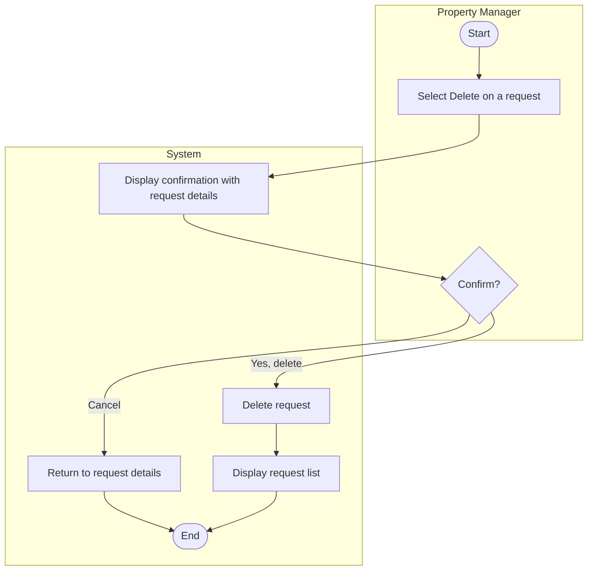

# UC-08 Delete Maintenance Request

## Specification

| Element | Specification |
|---|---|
| Name | Delete Maintenance Request |
| Goal | Remove a duplicate or mistaken request so the list stays accurate. Completed requests are kept as history with status Completed; delete is only for records that should never have existed (proposal: "authorized users may also delete duplicate requests") |
| Primary actor | Property Manager |
| Trigger | Property Manager selects the trash icon on the request list or **Delete** on request details |
| Precondition | Property Manager is logged in; the request exists |
| Success outcome | The request is removed and no longer appears in the list |
| Failure outcome | The request remains and the system explains why |

## Main success scenario

1. Property Manager selects **Delete** for a request.
2. System displays a confirmation page showing the request's details.
3. Property Manager selects **Yes, delete request**.
4. System deletes the request and returns to the request list.

## Alternative flows

| Branch | Condition | System response |
|---|---|---|
| 2a | Request id in the URL does not exist | Show "Maintenance request not found" |
| 3a | Property Manager selects **Cancel** | Return to request details with no change |
| 3b | Actor is a Resident (BR-04) | Show the unauthorized page |
| 4a | Unexpected processing error | Show a safe general message |

## Activity diagram

## Wireframes

- `docs/wireframes/10-delete-request.png` (delete confirmation page, `maintenance/delete-maintenance.php`)
- `docs/wireframes/05-maintenance-requests.png` (trash icon in Actions column, list after delete)
